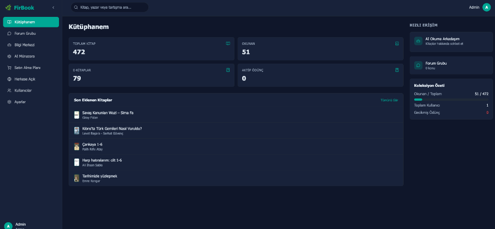

# FirBook (Kütüphane)



FirBook is a modern, web-based, AI-powered library management system. It provides a comprehensive solution for organizing your physical books and digital library (EPUB/PDF), complete with social features and AI integrations.

## 🚀 Key Features

- **Modern Dashboard**: Get a bird's-eye view of your library with statistics on total books, read books, e-books, and active loans.
- **Smart Book Search & Meta-Scraping**: Add books effortlessly by ISBN or Title/Author. The intelligent meta-scraper gathers metadata (cover, author, page count) from multiple sources without relying on fragile site-specific scrapers.
- **E-Book & Digital Library**: Seamlessly upload or link EPUB and PDF files. Books are automatically categorized as e-books based on assigned digital shelves or uploaded files.
- **AI Reading Companion (RAG)**: Chat with your books! The AI Reading Companion uses Retrieval-Augmented Generation (RAG) to let you ask questions and discuss contents directly from your uploaded documents.
- **Social & Community**: Engage in "Forum Groups" and "AI Debates" to discuss literature, share insights, and interact with an intelligent knowledge base.
- **Advanced Organization**: Custom shelves, tags, reading status tracking, and more.

## 🛠 Tech Stack

- **Backend**: FastAPI (Python), SQLAlchemy, PostgreSQL
- **Frontend**: React, TypeScript, Vite, Tailwind CSS, Shadcn UI
- **AI & Scraping**: DuckDuckGo Search (Meta-Search), LLM integrations for RAG and Summarization.
- **Infrastructure**: Docker & Docker Compose

## 📦 Quick Start (Development)

### Prerequisites
- Python 3.10+
- Node.js 18+
- PostgreSQL

### Backend Setup
```bash
cd backend
python -m venv venv
source venv/bin/activate
pip install -r requirements.txt
uvicorn app.main:app --reload
```

### Frontend Setup
```bash
cd frontend
npm install
npm run dev
```

## 🐳 Docker Deployment

The easiest way to run FirBook in production is via Docker Compose:

```bash
docker compose up -d --build
```

## 🔐 Default Access

- **Frontend**: `http://localhost`
- **API**: `http://localhost/api`
- **API Docs**: `http://localhost/api/docs`

*Note: The first registered user automatically becomes the administrator.*

## 🗄 Data Migration (SQLite -> PostgreSQL)

If you are migrating from an older SQLite setup:
```bash
# Ensure PostgreSQL is running and tables are created
cd backend
python migrate_data.py
```
